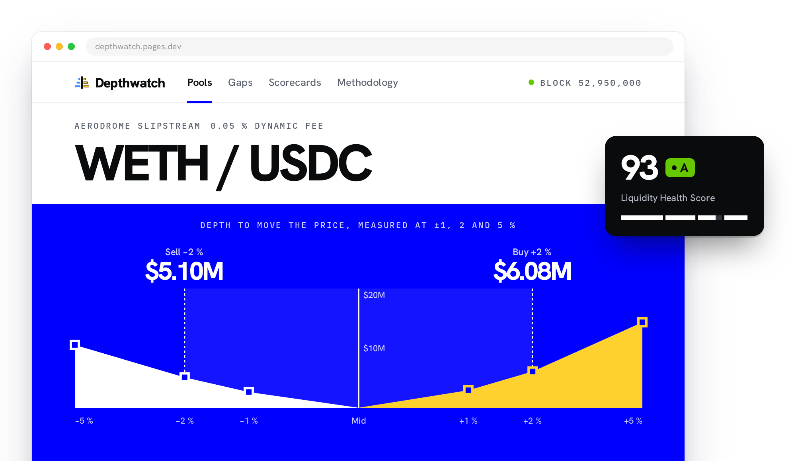

# Depthwatch

[![CI][ci-badge]][ci] [![Refresh site][refresh-badge]][refresh]

[ci-badge]: https://github.com/0xdeni/depthwatch/actions/workflows/ci.yml/badge.svg
[ci]: https://github.com/0xdeni/depthwatch/actions/workflows/ci.yml
[refresh-badge]: https://github.com/0xdeni/depthwatch/actions/workflows/refresh-site.yml/badge.svg
[refresh]: https://github.com/0xdeni/depthwatch/actions/workflows/refresh-site.yml

<picture>
  <source media="(prefers-color-scheme: dark)" srcset="docs/images/depthwatch-hero-dark.png" />
  
</picture>

Depthwatch is an open-source liquidity observatory for Base mainnet. For each Uniswap, Aerodrome
and Aero pool it tracks, it measures how much buying or selling it takes to move the price and
what a trade of a given size costs, and publishes the numbers through a dashboard, a REST API and
a command-line pipeline. A pool's size (its TVL) answers neither question; the liquidity close to
the current price does.

Depthwatch is independent: it is not affiliated with or endorsed by Base. It deploys nothing on
Base and sends no transactions of its own: the pipeline only reads Base mainnet over JSON-RPC, and
the dashboard's optional swap panel ([below](#the-dashboard)) hands a visitor's swap to the
visitor's own wallet.

**Live copy.** <https://depthwatch.pages.dev> is a static copy of the dashboard. This repository's
Refresh site workflow reads Base mainnet and publishes a new copy about every three hours; each
page says when it was read, and there is no API. The workflow's first run, on 29 October 2026,
had no 24 h volume and so an empty gaps feed: Base's public RPC refused the runner's `eth_getLogs`
requests. The workflow now sends them to the endpoint in the optional `DEPTHWATCH_LOGS_RPC_URL`
secret, if set, then to Tenderly's public gateway, not yet tried from a runner
([A free static copy](docs/DEPLOY.md#a-free-static-copy)).

**Why depth, not size.** Two WETH/USDC pools on Aero, in one snapshot of Base mainnet at block
53,219,391 (28 October 2026, 22:55 UTC):

| Pool                         | TVL     | Depth within ±2 % | $100,000 round trip |
| ---------------------------- | ------- | ----------------- | ------------------- |
| [Aero v2][aero-v2-weth]      | $6.59 M | $66,414           | 656.6 bps ($6,566)  |
| [Aero Slipstream][aero-weth] | $6.89 M | $2.87 M           | 9.9 bps ($99)       |

[aero-v2-weth]: https://basescan.org/address/0x800eb395b577b234c5065c8e0ccb0f3a1401b2c2
[aero-weth]: https://basescan.org/address/0x4a7af46bc8abc00048c6c7920a1488daf568366c

The two pools hold about the same capital. The v2 pool spreads its reserves over every possible
price; in the Slipstream pool LPs place liquidity in price ranges, much of it near the current
price. So the Slipstream pool has 43 times the depth within ±2 %, and buying and selling $100,000
of WETH costs $99 there against $6,566 in the v2 pool, fees included (0.30 % a swap in the v2
pool, 0.0345 % in the Slipstream pool at that block). Depth is both sides added: the USDC that
lifts the price 2 % plus the WETH that pushes it 2 % down, valued in USD
([docs/METRICS.md](docs/METRICS.md)).

Depthwatch indexes Uniswap v3, Uniswap v4, Aerodrome
(v2 AMM and Slipstream concentrated) and Aero (v2 AMM and Slipstream concentrated) pools on Base:
every pool of those factories with log discovery, or the pools between the 15 reference tokens (plus
any `--seed-token`), and those of the ten tokenized stocks with them, with `discover --seed`. On
2026-10-21 Aerodrome moved to a new platform, Aero, with new factories, a new AERO token and new
gauges; Aerodrome's pools still trade, so both are indexed, each pool under its own DEX id. It
publishes, per pool, how much capital it takes to move the price by 1, 2 and 5 percent in each
direction, the effective spread a trader pays on a $1k / $10k / $100k / $1M round trip with fees
included, how concentrated the liquidity is by tick range
and by owner, how stable that depth has been over the last 24 hours and 7 days, and a single 0–100
Liquidity Health Score, graded A–F for the pools deep enough to be rated (both sides of the ±2 %
depth known, the thinner holding at least $5,000; the others show "not rated" and why). A "liquidity
gaps" feed lists pools that have real trading volume but thin depth. Price trackers show price and
pool TVL; Depthwatch measures executable depth, which is what market makers quote against and what
protocol teams need when they evaluate one. Depthwatch measures and does not trade on its own
account: there is no token, no custody, no trading capital and no fee added to swaps. It is
indexing, analytics and a dashboard, released under MIT.

The same snapshots feed **market-maker scorecards**: a project registers a mandate (one pool,
the market maker's addresses, the depth and spread KPIs from its agreement) and gets a public
scorecard with uptime over 24 h / 7 d / 30 d, computed from the liquidity those addresses own
and reproducible block by block. See [Market-maker scorecards](#market-maker-scorecards).

**Status: MVP under active development; not yet validated against Base mainnet at scale.** The math
is unit-tested against hand-computed values and a brute-force simulator, and the pipeline runs end
to end against a synthetic fixture set, but coverage of the long tail of pools, USD pricing of
thinly traded tokens and RPC cost at full scale are still being measured. Numbers from a live
deployment, the live copy above included, should be read with that in mind until the validation
milestone in [docs/ROADMAP.md](docs/ROADMAP.md) is reached. What has run on mainnet so far, and
what it cost, is in [Measured on Base, 2026-10-25](#measured-on-base-2026-10-25) and
[2026-10-28](#measured-on-base-2026-10-28); the live copy's first run, on 29 October 2026, is in
[docs/DEPLOY.md](docs/DEPLOY.md#a-free-static-copy).

## What it measures

Every metric is defined once, in [docs/METRICS.md](docs/METRICS.md), and implemented once, in
`packages/core`. Summary:

| Metric                 | Question it answers                                                       | Unit                                |
| ---------------------- | ------------------------------------------------------------------------- | ----------------------------------- |
| Depth at ±1 / 2 / 5 %  | How much token1 (up) or token0 (down) moves the price by p %?             | raw token amounts and USD           |
| Effective spread       | What does a round trip of $1k / $10k / $100k / $1M cost, fees included?   | basis points                        |
| LP concentration       | Is in-band liquidity one range or many; how much does the top owner hold? | HHI 0..1, shares 0..1               |
| Liquidity persistence  | Over 24 h / 7 d, how much of the depth was there whenever we looked?      | stability 0..1, uptime 0..1         |
| Liquidity Health Score | 35 depth + 25 spread + 20 concentration + 20 persistence                  | 0–100; grade A–F if rated           |
| Gap score              | How large is 24 h volume relative to ±2 % depth?                          | 0–100 (turnover 1× → 0, 100× → 100) |
| TVL                    | Reserves at USD prices (lower bound when one side is unpriced)            | USD                                 |

Conventions that matter when reading the numbers: `price` is always token1 per token0, decimal
adjusted; fees are in pips (1e-6); the "up" side is buy pressure on token0 paid in token1 and the
"down" side is sell pressure paid in token0; USD prices come from a widest-path search over the
pools themselves, anchored at USDC and other stables, so a token with no deep route to a stable has
no USD price and its USD metrics are null rather than guessed.

## The dashboard

The overview page opens on the depth within ±2 % of the price summed over the scored pools, the
depth butterfly of the pools that hold it, three facts (24 h volume, median health, biggest gap)
and previews of the gaps feed and the market-maker scorecards. `pnpm depthwatch demo` serves it
from the synthetic fixture set with no RPC endpoint. `depthwatch export` and
`pnpm --filter @depthwatch/web build:static` turn a live database into a static copy that names
the block it was read at and says that it does not update. The live copy at
<https://depthwatch.pages.dev> is such a build, replaced by a new one about every three hours
([A free static copy](docs/DEPLOY.md#a-free-static-copy)).

**Swap panel.** A static copy has an optional swap panel, off unless the site's operator switches
it on ([Trade switch](docs/DEPLOY.md#trade-switch)); the footer of every page says which. When on,
it lets a visitor swap in the pool they are viewing, from their own wallet, straight to that pool's
router; it never routes or recommends a pool, never holds the visitor's funds and adds no fee. Each
swap carries Depthwatch's Builder Code (ERC-8021), which lets Base attribute the transaction
onchain; the code adds no fee, only 29 bytes of calldata (a negligible amount of gas).

A swap goes only to the router that `TRADE_ROUTES` (`packages/chain/src/addresses.ts`) binds to
the pool's venue and factory; the routers are compiled in, never taken from the data:

| Venue                  | Deployment   | Router                                                         | On hold |
| ---------------------- | ------------ | -------------------------------------------------------------- | ------- |
| `uniswap-v3`           | `uniswap-v3` | [`0x2626664c2603336e57b271c5c0b26f421741e481`][router-uniswap] | no      |
| `aerodrome-slipstream` | `initial`    | [`0xbe6d8f0d05cc4be24d5167a3ef062215be6d18a5`][router-initial] | no      |
| `aerodrome-slipstream` | `gauge-caps` | [`0xcbbb8035cac7d4b3ca7abb74cf7bdf900215ce0d`][router-caps]    | no      |
| `aerodrome-slipstream` | `gauges-v3`  | [`0x698cb2b6dd822994581fea6ea4fc755d1363a92f`][router-v3]      | no      |
| `aero-slipstream`      | `aero`       | [`0x9ee35bf1bd69a03c6f0393582030fce8bb93d418`][router-aero]    | yes     |

[router-uniswap]: https://basescan.org/address/0x2626664c2603336e57b271c5c0b26f421741e481
[router-initial]: https://basescan.org/address/0xbe6d8f0d05cc4be24d5167a3ef062215be6d18a5
[router-caps]: https://basescan.org/address/0xcbbb8035cac7d4b3ca7abb74cf7bdf900215ce0d
[router-v3]: https://basescan.org/address/0x698cb2b6dd822994581fea6ea4fc755d1363a92f
[router-aero]: https://basescan.org/address/0x9ee35bf1bd69a03c6f0393582030fce8bb93d418

A route on hold is never used, and the trade switch refuses a venue whose every route is on hold,
until the checks it waits for in [docs/research/base-contracts.md](docs/research/base-contracts.md)
are done. The panel offers a swap only in a pool whose two tokens are both in `TRADE_TOKENS`
(WETH, USDC, cbBTC, cbETH, wstETH, Aero's AERO, DAI, EURC, USDT, USDbC, DEGEN, VIRTUAL and BRETT;
native ETH trades as WETH), and the code caps a swap at $1,000 and 3 % slippage.

## Quick start

Requirements: Node ≥ 22.13 (see `.nvmrc`) and pnpm 10 (`corepack enable` is enough).

```sh
git clone https://github.com/0xdeni/depthwatch.git
cd depthwatch
pnpm install
cp .env.example .env             # set DEPTHWATCH_RPC_URL to a Base mainnet JSON-RPC endpoint

pnpm depthwatch discover --seed  # pools of the reference tokens from factory views, no eth_getLogs
pnpm depthwatch snapshot         # every pool's overview, USD prices, TVL rank, full depth for top N
pnpm depthwatch volume           # last 24 h of Swap events for tracked pools, hourly buckets in USD
pnpm depthwatch score            # persistence 24h/7d, health score and gap score per tracked pool
pnpm depthwatch serve            # REST API on :8787, plus the dashboard when apps/web/dist exists
```

A first seed is about 14,600 requests (about 10 minutes on Alchemy's free tier, some 50 minutes
at the public endpoint's 5 requests a second); a rerun takes seconds. A plain
`pnpm depthwatch discover` finds every pool of the indexed factories from their logs instead: from
the factories' deployment blocks that is about 126,000 `eth_getLogs` at the default 2,000-block
chunks at a head of 53.6 M (5 November 2026), about 7 hours at the public endpoint's rate, and an
interrupted scan resumes where it stopped. Since Base's Denim upgrade (2026-11-05) the chain grows
432,000 blocks a day, so a first scan grows by about 1,700 requests a day.

The CLI reads `./.env` when it exists (variables already set in the environment win) and flags win
over both; `pnpm depthwatch --help` lists them. `discover`, `snapshot`, `volume`, `positions`,
`run` and `start` read the chain and refuse to start without `DEPTHWATCH_RPC_URL` (or
`--rpc-url`): one line on stderr, exit code 1. Exit codes are 0 ok, 1 error, 2 usage (unknown
command, flag or value), 3 `export` refused `DEPTHWATCH_TRADE` and wrote the trade switch off. A pass that stored nothing because every item failed (`snapshot`,
`positions`, `mm sample`) exits 1 too, while a partial failure is a warning per item and exit 0;
`run --once` exits 1 when any step failed, and the `run` loop, which otherwise carries on past a
failed step, stops with exit 1 after three passes in a row in which every step that reads the
chain failed, so cron or a supervisor notices a revoked key instead of serving a stale site. Logs
go to stderr; stdout carries only program output: the `--help` and `--version` text, the URL line
of `serve`, `start` and `demo`, the summary line of `export`, and the scorecard URL, listing and
JSON of `mm register`, `mm list` and `mm show`.

Or run the whole pipeline on a loop (`--once` runs a single pass; each pass indexes the LP
positions of the pools with an active mandate, `--with-positions` those of every tracked pool):

```sh
pnpm depthwatch run --interval 300
```

Or, on a server, serve and keep the data fresh in one process (see
[Run it on a server](#run-it-on-a-server)):

```sh
pnpm depthwatch start
```

No RPC endpoint at hand? The demo runs the same pipeline over the synthetic fixture set into an
in-memory database and serves it. It makes no network calls and never opens `DEPTHWATCH_DB`, so
the live database from `.env` is safe; `--db <file>` keeps the synthetic world in a file instead,
provided the file is empty or was seeded by an earlier demo run:

```sh
pnpm depthwatch demo
```

Dashboard development runs separately from the API and proxies `/api` to port 8787:

```sh
pnpm --filter @depthwatch/web dev               # against a running `depthwatch serve`
VITE_MOCK=1 pnpm --filter @depthwatch/web dev   # against in-repo mock JSON, no backend
pnpm build                                      # builds apps/web/dist for `depthwatch serve`
```

The mock data is for development only: it is used with `VITE_MOCK=1`, or by the dev server when
`/api/health` does not answer. A production build (`pnpm build`) does not contain it. When the data
service does not answer, the dashboard shows "The data service is not answering." with a "Try
again" button that probes again, never made-up pools.

### Environment

Every variable but `DEPTHWATCH_ADMIN_TOKEN`, `DEPTHWATCH_SHUTDOWN_GRACE` and `DEPTHWATCH_TRADE` has
a flag with the same meaning. Flags win over the environment, which wins over `./.env`. Durations take units
(`90s`, `30m`, `6h`, `1d`); a plain number is seconds.

| Variable                        | Flag                   | Default                | Meaning                                                                                                                                                                                                                                                                                                                                                                                                                                     |
| ------------------------------- | ---------------------- | ---------------------- | ------------------------------------------------------------------------------------------------------------------------------------------------------------------------------------------------------------------------------------------------------------------------------------------------------------------------------------------------------------------------------------------------------------------------------------------- |
| `DEPTHWATCH_RPC_URL`            | `--rpc-url`            | none (required)        | Base mainnet JSON-RPC over http(s) (WebSocket URLs are refused), required by the live commands. Error messages keep only a URL's origin, never its key. `.env.example` points at the public `https://mainnet.base.org`; a paid endpoint is advisable for full snapshots.                                                                                                                                                                    |
| `DEPTHWATCH_LOGS_RPC_URL`       | `--logs-rpc-url`       | `DEPTHWATCH_RPC_URL`   | Endpoint for `eth_getLogs` only (`discover`, `volume`, `positions`); everything else stays on `DEPTHWATCH_RPC_URL`. Unset, logs use the main endpoint. See [Running on a free RPC](#running-on-a-free-rpc).                                                                                                                                                                                                                                 |
| `DEPTHWATCH_DB`                 | `--db`                 | `depthwatch.db`        | SQLite file; created and migrated on first run. `demo` ignores it: in-memory unless `--db` is given.                                                                                                                                                                                                                                                                                                                                        |
| `DEPTHWATCH_PORT`               | `--port`               | `PORT`, else `8787`    | Port for `serve`, `start` and `demo`. Unset, the `PORT` a hosting platform sets is used.                                                                                                                                                                                                                                                                                                                                                    |
| `DEPTHWATCH_HOST`               | `--host`               | `0.0.0.0`              | Interface for `serve`, `start` and `demo`.                                                                                                                                                                                                                                                                                                                                                                                                  |
| `DEPTHWATCH_TOP_POOLS`          | `--top`                | `200`                  | Pools (ranked by TVL) that get full depth snapshots.                                                                                                                                                                                                                                                                                                                                                                                        |
| `DEPTHWATCH_KEEP_DAYS`          | `--keep-days`          | `30`                   | `prune`, `run`, `start`: days of snapshots and hourly volume kept (snapshots at least 8). Scorecard samples keep 35 days, alerts 90.                                                                                                                                                                                                                                                                                                        |
| `DEPTHWATCH_SEED_TOKENS`        | `--seed-token`         | none                   | Token addresses seeded besides the reference tokens, comma-separated (the flag repeats): `discover --seed`, `run --seed` and `start` also ask each DEX for their pairs with the reference tokens and with each other, e.g. a project's own token.                                                                                                                                                                                           |
| `DEPTHWATCH_LOG_CHUNK`          | `--log-chunk`          | `2000`                 | Blocks per `eth_getLogs` request. Base's public RPC rejects larger spans; raise it on a provider that allows them, or set it to a capped plan's limit (10 on Alchemy's free tier) for short scans (24 h of `volume` is no longer one: [Running on a free RPC](#running-on-a-free-rpc)).                                                                                                                                                     |
| `DEPTHWATCH_LOG_LEVEL`          | `--log-level`          | `info`                 | `debug`, `info`, `warn`, `error` or `silent`; logs go to stderr.                                                                                                                                                                                                                                                                                                                                                                            |
| `DEPTHWATCH_PUBLIC_URL`         | `--public-url`         | `http://<host>:<port>` | Public base URL of the deployment: the scorecard link `mm register` prints and the `scorecardUrl` of webhook alerts are built from it.                                                                                                                                                                                                                                                                                                      |
| `DEPTHWATCH_ADMIN_TOKEN`        | —                      | unset                  | Bearer token that `POST /api/mm` and `DELETE /api/mm/:id` require (`serve`, `start` and `demo`), at least 32 characters (`openssl rand -hex 32`). A bearer secret: send it only over HTTPS, through a reverse proxy that terminates TLS and rate-limits ([docs/DEPLOY.md](docs/DEPLOY.md#a-reverse-proxy-with-tls)). Unset, those routes answer `403 registration disabled` and mandates are registered with `depthwatch mm register` only. |
| `DEPTHWATCH_SNAPSHOT_INTERVAL`  | `--snapshot-interval`  | `30m`                  | `start`: time between passes; each pass snapshots and scores.                                                                                                                                                                                                                                                                                                                                                                               |
| `DEPTHWATCH_VOLUME_INTERVAL`    | `--volume-interval`    | `1h`                   | `start`: time between volume runs.                                                                                                                                                                                                                                                                                                                                                                                                          |
| `DEPTHWATCH_POSITIONS_INTERVAL` | `--positions-interval` | `6h`                   | `start`: time between LP position runs; `off` disables them.                                                                                                                                                                                                                                                                                                                                                                                |
| `DEPTHWATCH_POSITIONS_BUDGET`   | `--positions-budget`   | `10m`                  | `start`: longest a positions run starts new work.                                                                                                                                                                                                                                                                                                                                                                                           |
| `DEPTHWATCH_DISCOVER_BUDGET`    | `--discover-budget`    | `15m`                  | `start`: longest factory-log discovery runs per pass; `off` leaves discovery to the seed.                                                                                                                                                                                                                                                                                                                                                   |
| `DEPTHWATCH_SHUTDOWN_GRACE`     | —                      | `8s`                   | `start`: how long SIGTERM waits for the step in flight before abandoning it.                                                                                                                                                                                                                                                                                                                                                                |
| `DEPTHWATCH_TRADE`              | —                      | `off`                  | `export`: the trade switch of the static site, written into the bundle's `features.trade` and into `flags.json` next to it: `off` or a comma-separated list of trade venues, such as `uniswap-v3`. An unknown venue, or one held in the code, writes the switch off and fails the export (exit code 3). See [docs/DEPLOY.md](docs/DEPLOY.md#trade-switch).                                                                                  |

### Running on a free RPC

`eth_getLogs` is what free plans limit, and only `discover` (unless `--seed`), `volume` and
`positions` send it. `DEPTHWATCH_LOGS_RPC_URL` moves those requests to a second endpoint while
multicalls and block headers stay on `DEPTHWATCH_RPC_URL`; with one URL nothing changes.
- **Rate limits and gateway failures** (HTTP 429, e.g. Base's public endpoint above 5 requests
  per second per IP; a gateway's 5xx such as a 504 "upstream request timeout" or Cloudflare's 524;
  a timeout or no answer) are retried on the same range with exponential backoff, 1 s doubling to
  30 s, eight times at most (`Retry-After` wins), each logged as a warning. Then the request fails
  as an ordinary error: a `run` pass logs the failed step and goes on.
- **Range limits.** A logs endpoint that cannot serve the `DEPTHWATCH_LOG_CHUNK` span, such as
  Alchemy's free tier (10 blocks) against the default 2,000, stops the command after the first
  request of each log scan (one per event source for `volume`; `positions` starts no further pool
  after the first refusal) with an error that names the provider's limit and the two fixes: set
  `DEPTHWATCH_LOGS_RPC_URL` to an endpoint that accepts larger ranges, or, for short scans, set
  `DEPTHWATCH_LOG_CHUNK` to the limit. A stated limit of at least 100 blocks gets ranges split to
  it instead (Tenderly's public gateway: 1,000), and a range refused for its result count, or whose
  answer is over viem's 10 MiB, is halved. The reason is read from the JSON-RPC error's message
  and, for a -32602 "invalid params", from its `data`, where some providers put it.
- **Without a key**, Tenderly's public gateway, `https://gateway.tenderly.co/public/base`, serves
  `eth_getLogs` of at most 1,001 blocks and 20,000 results (measured; its documentation says 3,000
  results), and 1 GB of answers a day per IP address
  ([Public endpoint limits](https://docs.tenderly.co/node-rpc/overview.md)). Its public endpoints
  are rate-limited, and production use takes a dedicated node
  ([Supported networks](https://docs.tenderly.co/platform/supported-networks.md)). Use it with
  `DEPTHWATCH_LOG_CHUNK=1000`: since Denim a 1,000-block request covers 200 s of chain, less than
  the 500 s of the 250-block requests that kept the busiest window measured on 2 s blocks
  (28–29 October 2026) under both limits and under viem's 10 MiB (an inference from block times,
  not a measurement on 200 ms blocks). `DEPTHWATCH_LOG_CHUNK=250` still suits busy windows of the
  2 s blocks before Denim. The Refresh site workflow uses 1,000 when its optional
  `DEPTHWATCH_LOGS_RPC_URL` secret is unset or fails
  ([The logs endpoint](docs/DEPLOY.md#the-logs-endpoint)).
- **On a 10-block plan** (Alchemy's free tier), seed instead of scanning factory logs, snapshot and
  score as usual, and send `volume`'s logs to an endpoint that takes wider ranges:

  ```sh
  depthwatch discover --seed              # pools of the reference tokens, no eth_getLogs
  depthwatch snapshot
  DEPTHWATCH_LOGS_RPC_URL=https://mainnet.base.org depthwatch volume   # a host with its own IP
  depthwatch score
  ```

  or the same variable with `depthwatch run --seed --once`. Since Denim (2026-11-05 18:00 UTC) Base
  makes five blocks a second, 18,000 an hour, and at 10 blocks per request volume costs one
  `eth_getLogs` per 10 blocks per event source (three for six DEXes: Uniswap v3 and both
  Slipstreams share one, Aerodrome v2 and Aero v2 another): a first pass over 24 h is 432,000 to
  450,000 blocks, about 130,000 to 135,000 requests and about 10 M compute units with all six DEXes
  tracked, ten times the pass measured on 2 s blocks on 2026-10-28 (13,593 chunks in 15,855 HTTP
  requests, 2,256 of them answered HTTP 429 and retried, about 1.02 M units:
  [Measured on Base, 2026-10-28](#measured-on-base-2026-10-28)). A later pass starts at the hour
  that held the previous pass's head, so it rereads up to an hour: up to about 1,950 requests per
  event source five minutes after the last pass, up to 3,600 an hour after. Keeping volume current
  therefore reads every block at least once per source: at least 43,200 requests per source and
  about 130,000 for three a day, about 9.7 M units, so a 30 M-unit free month lasts about three
  days, and a 5-minute loop rereads so much that it costs about seven times that. On such a plan
  `volume` fits only short single passes (`DEPTHWATCH_LOG_CHUNK=10 depthwatch volume --hours 1`,
  or `2`: 1,800 to 5,400 requests per source, and the score's 24 h volume then counts only the
  hours read), or not at all.

  `discover --seed` asks each DEX's factory (StateView for Uniswap v4) for every pair of the
  reference tokens in `packages/chain/src/addresses.ts` and of the tokens given with `--seed-token`
  (`DEPTHWATCH_SEED_TOKENS`, e.g. a project's own token), and for each of the ten tokenized stocks
  of `packages/chain/src/stocks.ts` with each of those tokens (never two stocks: 6,200 calls more,
  docs/ARCHITECTURE.md "Seeded discovery"), and dates each new pool exactly by binary
  search over archive state, about 26 to 27 requests per pool (log2 of the height), storing every 50
  pools so an interrupted seed resumes. A DEX whose factory reads fail does not hold the others
  back: their pools are stored, the failure is logged and the next seed asks that DEX again. On Base
  on 2026-10-25 that was 580 pools in about 10 minutes and 13,399 search requests (some 349,000
  compute units, see [Measured on Base](#measured-on-base-2026-10-25)), once; a rerun takes seconds.
  `positions` and 24 h of `volume` are impractical on such a plan alone, and pools outside the
  seeded pairs are only found by the log-based `discover`: all three need a logs endpoint that takes
  2,000-block spans, such as `https://mainnet.base.org` from a host with its own IP. `discover`
  saves its cursor every 50 chunks, so an interrupted scan resumes where it stopped; seeding never
  moves that cursor.

[docs/ARCHITECTURE.md](docs/ARCHITECTURE.md#rate-limits-range-limits-and-free-plans) has the
request counts.

### Measured on Base, 2026-10-25

Both passes recorded here ran on Base's 2 s blocks, before Denim's 200 ms blocks (2026-11-05 18:00
UTC): their `volume` figures count 2 s blocks, a tenth of what 24 h holds now. The first ran
against Base mainnet on 2026-10-25 through Alchemy's free tier, with every HTTP request counted:
- **`discover --seed`**: 2,782 candidate pairs gave 580 pools (Uniswap v3 227, Uniswap v4 165,
  Aerodrome v2 87, Slipstream 101) at head 53,061,869, in 616 s. Dating them took 13,399 search
  requests; 15,388 HTTP requests in all, 1,968 of them answered HTTP 429 and retried; about
  349,000 compute units.
- **`snapshot`** over the 492 tracked pools (of the 580): about 1,150 requests, about 29,000
  compute units and under a minute per pass.
- **`volume`** at 10-block chunks over 24 h (blocks 53,016,926 to 53,062,226): 492 pools, 267,572
  swaps in 3,501 hourly buckets, in 36.5 minutes; 22,323 HTTP requests, 18,131 served and 4,192
  answered HTTP 429 and retried, about 1.36 M compute units. That pass read four scans, one per
  DEX; Uniswap v3 and Slipstream have shared one filter since, so on 2 s blocks the same pass
  would have been about 13,600 requests and about 1 M units, as the 2026-10-28 pass below found;
  on 200 ms blocks it is ten times that ([Running on a free RPC](#running-on-a-free-rpc)).
- **Quoter cross-checks** at block 53,063,332, $10k and $100k each way, matched the stored average
  prices on Uniswap v3, Slipstream and Aerodrome v2 pools; on Uniswap v4 they found the protocol
  fee, which the swap walk has charged since
  ([docs/research/base-contracts.md](docs/research/base-contracts.md) §2.8).

What this did not cover, so the status above stands: only pools between the reference tokens
(the seed; no factory-log discovery), 24 h of volume, no LP ownership (`positions` needs a logs
endpoint that takes 2,000-block spans), no 7-day run and no swap cross-check
([docs/ROADMAP.md](docs/ROADMAP.md), week 4).

### Measured on Base, 2026-10-28

A second pass ran on 2026-10-28, after Aerodrome's move to Aero, on all six DEXes through the same
free tier, again with every HTTP request counted and on 2 s blocks:
- **`discover --seed`**: 4,060 candidate pairs gave 644 pools (Uniswap v3 235, Uniswap v4 166,
  Aerodrome v2 87, Aerodrome Slipstream 101, Aero v2 21, Aero Slipstream 34) at head 53,218,002,
  in 631 s; 15,135 HTTP requests, 490 of them answered HTTP 429 and retried; about 381,000
  compute units.
- **`snapshot`** over the 552 tracked pools: about 1,320 requests and about 33,000 compute units
  per pass, about a minute each, at blocks 53,218,323, 53,219,192 and 53,219,391.
- **`volume`** at 10-block chunks over 24 h (blocks 53,173,059 to 53,218,359), three event
  sources: 13,593 chunks in 27.6 minutes; 15,855 HTTP requests, 13,599 served and 2,256 answered
  HTTP 429 and retried, about 1.02 M compute units; 362,121 swaps in the 24 h window.
- **Where the depth sits**: of the $87.4 M within ±2 % of the price, the Aero factories held
  $26.3 M (30.1 %) and the original Aerodrome factories $7.2 M (8.3 %); of the $449.1 M traded in
  24 h, Aero carried $233.7 M (52.0 %) and Aerodrome $69.2 M (15.4 %). The 163 tracked pools whose
  quote sat 5 % or more off the USD price graph are left out of the depth sums, which the
  2026-10-25 pass did not do, so the two totals are not comparable.
- **Coverage**: the seed found 21 of the 300 Aero v2 pools and 34 of the 489 Aero Slipstream pools
  that the factories listed at block 53,213,030 (reference-token pairs only).
- **Independent check**: ETH and cbBTC prices, the ±2 % depth of the deepest Aero Slipstream pool
  and of an Aero v2 pool, and the hourly swaps of five pools reproduced from direct RPC reads and
  Swap logs at block 53,219,391.

The limits of the 2026-10-25 pass apply here too: the seed only, 24 h of volume, no LP ownership.

### CLI commands

| Command                                                                                                                             | What it does                                                                                                                                                                                                                                                                                                                                                                                                                                                                                                                                                                                                                                                                                                                                       |
| ----------------------------------------------------------------------------------------------------------------------------------- | -------------------------------------------------------------------------------------------------------------------------------------------------------------------------------------------------------------------------------------------------------------------------------------------------------------------------------------------------------------------------------------------------------------------------------------------------------------------------------------------------------------------------------------------------------------------------------------------------------------------------------------------------------------------------------------------------------------------------------------------------- |
| `discover [--dex <dex,…>] [--from-block N] [--seed [--seed-token <address>]]`                                                       | Scan factory / PoolManager logs in chunks, upsert pools and advance the last block per DEX every 50 chunks, logging progress and ETA; a rerun resumes. `--seed` reads no logs: it asks each DEX for the pools of every pair of the reference tokens and the `--seed-token` addresses, and of each tokenized stock with them, finds each new pool's creation block by binary search over archive state, upserts the pools and records `seed:<dex>:lastBlock`, leaving the log cursors alone. A DEX whose factory reads fail is logged and gets no `seed:<dex>:lastBlock`; the other DEXes' pools are stored and the command exits 1.                                                                                                                |
| `snapshot [--top N] [--pool <id>…]`                                                                                                 | Read every pool's overview, derive USD prices, rank by TVL, read tick state for the top N (plus every pool with an active mandate and every tokenized stock's pool ranked at $10,000 or more), compute depth, spread and concentration, insert snapshots, rebuild `prices`; sample every active mandate of a snapshotted pool and deliver alerts.                                                                                                                                                                                                                                                                                                                                                                                                  |
| `volume [--hours 24]`                                                                                                               | Fetch Swap events for tracked pools, bucket per hour, value in USD. A later pass starts at the hour that held the previous pass's head (`volume:<pool>:lastBlock`), rewrites that hour and keeps the ones before it; a newly tracked pool, or a wider `--hours`, reads the whole window.                                                                                                                                                                                                                                                                                                                                                                                                                                                           |
| `positions`                                                                                                                         | Index LP positions (owners, ranges, liquidity) for tracked concentrated pools and concentrated pools with an active mandate, and the Slipstream gauge that holds staked positions for their depositors (not an owner).                                                                                                                                                                                                                                                                                                                                                                                                                                                                                                                             |
| `score`                                                                                                                             | Persistence 24 h / 7 d from stored snapshots, 24 h volume, health score, gap score; scores of pools no longer tracked are deleted.                                                                                                                                                                                                                                                                                                                                                                                                                                                                                                                                                                                                                 |
| `prune [--keep-days 30]`                                                                                                            | Retention, database only: delete snapshots and hourly volume older than `--keep-days` (snapshots keep at least 8 days), scorecard samples older than 35 days, alerts older than 90 (but each mandate's newest delivered alert), and the volume cursors of pools no longer tracked; snapshots go in batches of 10,000 rows, and the WAL is checkpointed at the end. `run` and `start` run it once a day.                                                                                                                                                                                                                                                                                                                                            |
| `run [--interval 300] [--once] [--with-positions] [--seed] [--keep-days 30]`                                                        | Loop: discover → snapshot → volume → score, plus `prune` once a day. `--interval` takes seconds or a duration (`5m`); `--once` runs a single pass and exits 1 if a step failed; each pass indexes the positions of the concentrated pools with an active mandate before its snapshot, `--with-positions` those of every tracked pool; `--seed` makes each pass's discover step seed instead of scanning logs. The loop carries on past a failed step and stops with exit 1 after three passes in a row whose every chain step failed.                                                                                                                                                                                                              |
| `start [--snapshot-interval 30m] [--volume-interval 1h] [--positions-interval 6h] [--positions-budget 10m] [--discover-budget 15m]` | The server: API and dashboard as `serve` does, listening at once, plus the pipeline on a schedule in the same process. Each pass (every 30 min) snapshots and scores, runs volume hourly and positions every 6 h within a budget (at once for a mandate whose pool has no positions yet), and discovers from factory logs within a budget, and prunes once a day; on an empty database the first pass seeds first. Failing steps are logged and retried; every step logs its requests and estimated Alchemy compute units, and each day a total. An unwritable database is refused at start-up. SIGTERM stops the step in flight, which stores nothing more, and exits 0 within `DEPTHWATCH_SHUTDOWN_GRACE`. See [docs/DEPLOY.md](docs/DEPLOY.md). |
| `serve [--port N] [--host H]`                                                                                                       | API and dashboard (`apps/web/dist`, once `pnpm build` has run).                                                                                                                                                                                                                                                                                                                                                                                                                                                                                                                                                                                                                                                                                    |
| `demo [--port N] [--db <file>]`                                                                                                     | Seed an in-memory database (or an empty / demo-seeded `--db` file; `DEPTHWATCH_DB` is ignored) from the synthetic fixture set, register two demo mandates and serve; works offline.                                                                                                                                                                                                                                                                                                                                                                                                                                                                                                                                                                |
| `export --out <file> [--demo] [--note <text>] [--bundle <file>]`                                                                    | Write the static dashboard bundle (JSON) of the database, read through the API; `pnpm --filter @depthwatch/web build:static` builds the site from `apps/web/static-data/bundle.json` (the root `pnpm build:static` re-exports the demo bundle over it first). `--demo` bundles the offline demo instead. A live bundle's site says it is a Base mainnet snapshot with its UTC time that does not update; `--note` adds the text of its “About this snapshot” popover. It also writes `flags.json` next to the bundle, the trade switch from `DEPTHWATCH_TRADE` (off by default). `--bundle <file>` writes an exported bundle again with only that switch changed, reading no database (the Trade switch and Trade preview workflows).              |
| `mm register --file <json>`                                                                                                         | Validate a registration JSON ([docs/SCORECARDS.md](docs/SCORECARDS.md)), store the mandate (an existing id is replaced, keeping its `active` flag and registration time unless the file sets them, and its samples and alerts), print its scorecard URL. The pool is tracked from the next `snapshot` on; a pool not discovered yet is a warning and is sampled once `discover` finds it.                                                                                                                                                                                                                                                                                                                                                          |
| `mm list`                                                                                                                           | Every mandate with its status.                                                                                                                                                                                                                                                                                                                                                                                                                                                                                                                                                                                                                                                                                                                     |
| `mm show <id>`                                                                                                                      | The scorecard summary (status, uptime 24 h / 7 d / 30 d, worst excursions, current streak, latest sample) as JSON.                                                                                                                                                                                                                                                                                                                                                                                                                                                                                                                                                                                                                                 |
| `mm deactivate <id>`                                                                                                                | Stop sampling a mandate; its scorecard stays served as `inactive`.                                                                                                                                                                                                                                                                                                                                                                                                                                                                                                                                                                                                                                                                                 |
| `mm sample`                                                                                                                         | Sample every active mandate now against the latest block (pool state from the chain, positions from the database) without waiting for the next `snapshot`.                                                                                                                                                                                                                                                                                                                                                                                                                                                                                                                                                                                         |

`--dex` takes `uniswap-v3`, `uniswap-v4`, `aerodrome-v2`, `aerodrome-slipstream`, `aero-v2` or
`aero-slipstream` (repeatable or comma-separated); `--pool` takes pool ids such as
`uniswap-v3:0x…` (repeatable). The global flags `--db`, `--rpc-url`, `--logs-rpc-url`,
`--log-chunk`, `--log-level`, `--port`, `--host`, `--top` and `--public-url` mirror the
environment variables above. Ctrl-C finishes the current step and
shuts down cleanly; `start` stops the step in flight instead, so SIGTERM ends it within seconds.
`mm sample` is a live command like `snapshot`; the other `mm` commands only touch the database.

### Run it on a server

`depthwatch start` is the one command a server runs: the website and the API, listening at once,
and the pipeline on a schedule in the same process, against one SQLite file. Its defaults fit
Alchemy's free tier for `DEPTHWATCH_RPC_URL` with `eth_getLogs` on Base's public RPC
(`DEPTHWATCH_LOGS_RPC_URL=https://mainnet.base.org`) from a host with its own IP address.
[docs/DEPLOY.md](docs/DEPLOY.md) lists what the host needs, the settings, the disk the database
takes (bounded by `DEPTHWATCH_KEEP_DAYS`: about 80 MB a day of snapshots at 200 pools every 5
minutes before pruning, a sixth of that at `start`'s 30 minutes) and how to follow the request
budget in the logs; [docs/ARCHITECTURE.md](docs/ARCHITECTURE.md#running-as-a-service)
explains the schedule. The `Dockerfile` at the root packages that process as an image and
[deploy/compose.yaml](deploy/compose.yaml) runs it; the [Docker](docs/DEPLOY.md#docker) section
of docs/DEPLOY.md has the commands. Without a server, a scheduled GitHub Actions workflow
publishes a static copy to Cloudflare Pages about every three hours at no cost; this repository's
copy is <https://depthwatch.pages.dev> ([A free static copy](docs/DEPLOY.md#a-free-static-copy)).

`serve`, `start` and `demo` listen on `0.0.0.0` unless `--host` says otherwise and log one
`request` line per request (method, path without the query string, status, milliseconds) and an
`admin request refused` warning for each `401` on `POST /api/mm` or `DELETE /api/mm/:id`, with the
reason and the peer address. The server does not terminate TLS or limit request rates: on a public
host it belongs behind a reverse proxy that does both, since `DEPTHWATCH_ADMIN_TOKEN` travels in
the `Authorization` header ([docs/DEPLOY.md](docs/DEPLOY.md#a-reverse-proxy-with-tls)).

## Architecture

A pnpm workspace with three library packages and three apps. The dependency direction is strict:
`core` has no dependencies and does no I/O; everything else builds on it.

| Path             | Package             | Responsibility                                                                                                            |
| ---------------- | ------------------- | ------------------------------------------------------------------------------------------------------------------------- |
| `packages/core`  | `@depthwatch/core`  | Tick math, swap simulation for all three pool kinds, every metric, USD price graph. Pure.                                 |
| `packages/chain` | `@depthwatch/chain` | viem adapters for Base: discovery, overview, tick-bitmap state walks, positions, swaps; fixture and recording transports. |
| `packages/db`    | `@depthwatch/db`    | `node:sqlite` schema, migrations and typed repositories.                                                                  |
| `apps/api`       | `@depthwatch/api`   | Hono REST API with zod validation; serves the built dashboard.                                                            |
| `apps/web`       | `@depthwatch/web`   | Vite + React dashboard; reads `/api` (or the static bundle); the swap panel, when on, also talks to the visitor's wallet. |
| `apps/cli`       | `@depthwatch/cli`   | The `depthwatch` command: the pipeline above.                                                                             |

Data flows discover → overview → prices → rank → state → metrics → snapshots → volume → scores →
API → web. [docs/ARCHITECTURE.md](docs/ARCHITECTURE.md) describes each step, the RPC cost model
(multicall batching, tick-bitmap walks, chunked `getLogs`), the storage model and how to add a DEX
adapter. [DESIGN.md](DESIGN.md) is the contract between packages.

## API

Responses are JSON (except the badge SVG and the agent documents); bigints are decimal strings.
Invalid query parameters return `400 { "error", "issues" }`; unknown pools, tokens or stocks return
`404 { "error" }`. Pool ids contain a colon (`uniswap-v3:0x…`, `uniswap-v4:0x<poolId>`) and may be
percent-encoded. Listings cover scored pools only; a pool that has been discovered but not
snapshotted and scored yet still answers on `/api/pools/:id` with `null` metrics. Responses are
gzip-compressed when the client accepts it and carry an `ETag` (`304` on a matching
`If-None-Match`); successful `GET /api/*` responses carry `Cache-Control: public, max-age=30`
(`/api/health`: none; the badge: `max-age=300`; a pool's history: `max-age=60`), the dashboard's hashed `/assets/*` files
`public, max-age=31536000, immutable` and `index.html` `no-cache` (also where it answers a navigation to a missing
`/assets/*` file).

| Route                                                | Returns                                                                                                                                                                                                                                                                                                                                                                                                                                                                                                                                                                                           |
| ---------------------------------------------------- | ------------------------------------------------------------------------------------------------------------------------------------------------------------------------------------------------------------------------------------------------------------------------------------------------------------------------------------------------------------------------------------------------------------------------------------------------------------------------------------------------------------------------------------------------------------------------------------------------- |
| `GET /api/health?maxAge=`                            | `{ ok, poolCount, trackedCount, latestSnapshotAt, latestScoredAt, snapshotAgeSeconds, latestBlock, source }` (`latestScoredAt`: the newest score, which a pass writes after its snapshots; `snapshotAgeSeconds`: server clock minus `latestSnapshotAt`, `null` before the first snapshot; `source` is `demo` or `live`); `503 { ok: false, error }` when the database cannot be read or, with `maxAge` (seconds), when the newest snapshot is older than that or missing (`error: stale: …`, counts kept); `400` for an invalid `maxAge`                                                          |
| `GET /api/stats`                                     | `{ byDex: [{ dex, pools, tracked, scored, rated, depth2Usd, depthKnownPools, volume24hUsd, medianHealth }], totals }`: per DEX and overall, the sum of ±2 % depth (stale quotes and pools unrated `transfers-paused` left out) with the number of pools it covers, the sum of 24 h volume and the median health over rated pools (`null` when none is rated)                                                                                                                                                                                                                                      |
| `GET /api/pools`                                     | `{ items: PoolSummary[], total }`; query `sort=health\|depth\|volume\|gap\|tvl\|spread\|top` (default `health`; `spread` is `spread10kBps`, `top` is `ownerTop1Share`), `dir=asc\|desc` (default `desc`), `dex`, `q` (substring of a token symbol or address, pool address or v4 pool id), `minVolume` (USD), `rated=true\|false`, `limit` (default 50, max 200), `offset`                                                                                                                                                                                                                        |
| `GET /api/pools/:id`                                 | `{ pool, tracked, latest, score, gap, persistence24h, persistence7d, volume24hUsd, scoredAt }`; `latest` is the newest snapshot; it and the score fields are `null` until the pool has been snapshotted and scored                                                                                                                                                                                                                                                                                                                                                                                |
| `GET /api/pools/:id/history?window=24h\|7d`          | `{ window, from, to, points: [{ timestamp, price, depth2Usd, spread10kBps, tvlUsd, health, feePips }] }` (`feePips`: the fee that snapshot used); the window ends at the pool's newest snapshot; `Cache-Control: public, max-age=60`                                                                                                                                                                                                                                                                                                                                                              |
| `GET /api/gaps?limit=&offset=&minVolume=`            | `{ items: [{ pool: PoolSummary, gap: { volume24hUsd, depth2Usd, turnoverRatio, gapScore } }], total, meaningful, minVolumeUsd }`: pools with 24 h volume ≥ `minVolume` (default $10k) ranked by gap score; `total` counts the whole feed and `meaningful` its pools trading 3× their ±2 % depth or more, ignoring `limit` / `offset`                                                                                                                                                                                                                                                              |
| `GET /api/tokens/:address`                           | `{ token, usd, via, priceUpdatedAt, pools: PoolSummary[], total, poolCount, depth2UsdTotal, depthKnownPools }`: USD price with the pool ids it was derived through (plus `wrap:weth` for the ETH ↔ WETH step), and the scored pools containing the token (`sort`, `dir`, `limit`, `offset` as for `/api/pools`; default deepest first); `depth2UsdTotal` sums the ±2 % depth of every scored pool of the token with a known depth, no stale quote and transfers not paused (`depthKnownPools` of them), whatever the page                                                                         |
| `GET /api/stocks`                                    | `{ items: StockSummary[] }`: every tokenized stock of the stock list the snapshot step writes, with pools or not, by `depth2BuyUsd + depth2SellUsd` descending (`null` last), then ticker; each is `{ stock: { token, ticker, feed }, reading, ...aggregates, updatedAt }`: the newest Chainlink reading (`referenceStatus`, `referenceUsd`, `feedAgeSeconds`, `transfersPaused`, …) and core's aggregates over its scored pools (TVL, ±2 % buy and sell depth, the best $10k spread, 24 h volume, `venues`, the deepest pool and its deviation from the feed; docs/METRICS.md, Stock aggregates) |
| `GET /api/stocks/:token`                             | The `StockSummary` plus `pools: [{ pool: PoolSummary, stockIs, depth2BuyUsd, depth2SellUsd, counted, reference }]`, every scored pool of the stock oriented to it, the counted pools (no stale quote, transfers not paused) first, then the larger thinner side; `400` for a malformed address, `404 { error: 'stock not found' }` for a token the stock list lacks                                                                                                                                                                                                                               |
| `GET /api/mm?pool=&active=`                          | `{ items: ScorecardSummary[] }`: one scorecard per registered mandate (mandate with `alertWebhookConfigured`, never the webhook URL; latest sample, uptime 24 h / 7 d / 30 d, worst excursions, current streak, status), active first then by name; `pool` filters by pool id, `active` by `true` / `false`                                                                                                                                                                                                                                                                                       |
| `GET /api/mm/:id`                                    | `ScorecardSummary & { pool: PoolSummary \| null }`; 404 for an unknown id                                                                                                                                                                                                                                                                                                                                                                                                                                                                                                                         |
| `GET /api/mm/:id/samples?window=24h\|7d\|30d&limit=` | `{ window, from, to, points: MmSample[] }` ascending by time; default `7d`; `limit` (default and maximum 10 000) keeps the newest samples of the window                                                                                                                                                                                                                                                                                                                                                                                                                                           |
| `GET /api/mm/:id/badge.svg`                          | SVG badge `depthwatch \| <status> · 7d <uptime>%` (green `ok`, red `breached`, grey `no-data` and `inactive`; `n/a` while the window has no evaluable sample); `image/svg+xml`, `Cache-Control: public, max-age=300`                                                                                                                                                                                                                                                                                                                                                                              |
| `POST /api/mm`                                       | Register a mandate (body: the registration JSON; an existing id is replaced, its samples kept, and its `active` flag and registration time unless the body sets them); requires `Authorization: Bearer <DEPTHWATCH_ADMIN_TOKEN>`; 201 with the summary, 400 with the validation problems, 401 for a missing or wrong token, 403 `registration disabled` when no token is configured, 413 for a body over 64 KiB                                                                                                                                                                                   |
| `DELETE /api/mm/:id`                                 | Remove a mandate together with its samples and alerts → `{ id, deleted, samplesDeleted, alertsDeleted }`; same authorization as `POST`; 404 for an unknown id                                                                                                                                                                                                                                                                                                                                                                                                                                     |
| `GET /AGENTS.md`                                     | Guide for AI agents using the API (conventions and units, every GET route, curl examples, how to pick a pool for a trade); `text/markdown; charset=utf-8`                                                                                                                                                                                                                                                                                                                                                                                                                                         |
| `GET /llms.txt`                                      | llms.txt index of the agent documents and the main routes; `text/plain; charset=utf-8`                                                                                                                                                                                                                                                                                                                                                                                                                                                                                                            |
| `GET /openapi.json`                                  | Hand-written OpenAPI 3.1 description of every GET route and its response schema; `application/json`                                                                                                                                                                                                                                                                                                                                                                                                                                                                                               |

`PoolSummary` is `{ pool, price, tvlUsd, depth2Usd, depth2UpUsd, depth2DownUsd, spread10kBps,
priceDeviationBps, staleQuote, health: { total, grade, rated, unratedReason, concentrationBasis },
gapScore, volume24hUsd, ownerTop1Share, updatedAt }` (`ownerTop1Share`: the largest LP's share,
`null` unless indexed owners in the band cover at least 90 % of the pool's in-band liquidity);
`depth2UpUsd` and `depth2DownUsd` are the buy and sell sides of the ±2 % depth from the newest
snapshot (`null` for a side whose token has no USD price). `health` is always present: `grade` is
`null` and `rated` false for a pool whose thinner ±2 % side holds under $5,000, with `unratedReason`
`thin`, `one-sided` or `unpriced`, for a pool with a swap hook Depthwatch does not model
(`hooked`: a Uniswap v4 pool with a hook, or an Aero Slipstream pool off its reviewed hook; no
depth, spread or concentration computed), or for a pool of a tokenized stock whose transfers are
paused at the snapshot's block (`transfers-paused`: every swap in it reverts, and its depth is
left out of the depth sums, as a stale quote's); its `total` is kept.
`concentrationBasis` says what the 20
concentration points rest on: `owners` (indexed owners covering at least 90 % of the in-band
liquidity), `ranges` (the range HHI) or `neutral` (docs/METRICS.md). `priceDeviationBps` is how far
the pool's price is from the one its tokens' USD prices imply, and `staleQuote` is true from 500
bps: such a pool's depth is left out of the depth sums (the stats and a token's `depth2UsdTotal`)
and sorts last on depth (docs/METRICS.md, Stale quotes). Every token object (`pool.token0`,
`pool.token1`, `TokenDetail.token`) adds `label`, the name to display: the symbol, or `SYMBOL
(name)` when another token of a scored pool shares that symbol (`AERO (Aerodrome)`, `AERO (Aero)`),
or `SYMBOL (0x3f5b…a4ee)` when the name is shared too; the address stays the identity. Every other
`null` means "not measured (yet)". On the stock routes, `referenceUsd` is Chainlink's answer passed
on with its status and age, and a stock's `usd` (`/api/tokens/:address`) the price graph's
valuation convention for depth and TVL; Depthwatch publishes no stock price, and the routes measure
the stocks' markets without offering, routing or recommending trades in them (Coinbase tokenized
stocks are only available to persons in eligible jurisdictions outside of the U.S.).

## For AI agents

Base presents itself as the chain for onchain trading, payments and agents; Depthwatch measures
the liquidity that trades on Base execute against.
- [AGENTS.md](AGENTS.md) at the repository root is for coding agents working on this repository:
  layout, commands, the conventions that bite, where Base contract addresses come from.
- Every running server (`depthwatch serve`, `start` and `demo`) serves the documents for agents
  that use the API: [`/AGENTS.md`](apps/api/src/agentDocs/AGENTS.md) (conventions and units,
  every GET route, curl examples, how to pick a pool for a trade, how to read a stock's liquidity),
  [`/llms.txt`](apps/api/src/agentDocs/llms.txt) (an llms.txt index) and
  [`/openapi.json`](apps/api/src/agentDocs/openapi.json) (OpenAPI 3.1 of the GET routes). They
  are written once, in `apps/api/src/agentDocs/`; `pnpm build` and `pnpm build:static` ship the
  same files with the dashboard, the static copies with a note that the static site serves only
  the bundled JSON, not the API.

## Market-maker scorecards

A mandate names one pool, the market maker's addresses (position owners on Uniswap v3 / v4 and
Slipstream, gauge depositors for staked Slipstream positions, LP-token holders on Aerodrome v2 and
Aero v2, staked LP tokens included) and the KPIs of the agreement: `minDepthUsd` on each side at
`±bandPct` (default 2 %), optionally `maxSpreadBps` at `spreadNotionalUsd` (default $10k), and an
informational `targetUptime`. Every snapshot of the pool yields one sample: the depth and spread
of a pool state that contains only the market maker's positions (or the reserves scaled by its LP
share), evaluated against the KPIs with the same core code as the pool metrics. A sample whose USD
price is missing is stored but not evaluated. The scorecard reports the latest sample, uptime
(share of evaluable samples within KPI) over 24 h, 7 d and 30 d, the worst excursions, the current
streak and a status (`ok`, `breached`, `no-data`, `inactive`); an optional webhook (an `http(s)`
URL at a public host; redirects are not followed) receives a `breach` event once a breach has
lasted `alertAfterSamples` samples (default 3), retried at the following samples while
undelivered, and a `recovered` event once a delivered breach is over. The webhook URL is a secret
(whoever has it can post through it): it stays in
the database, and the API, the export and the dashboard say only whether one is set
(`alertWebhookConfigured`).

```sh
pnpm depthwatch mm register --file mandate.json   # prints http://…/mm/<id>
pnpm depthwatch mm show <id>                      # the summary as JSON (webhook URL masked)
```

The scorecard lives at `/mm/<id>` on the dashboard, `GET /api/mm/<id>` on the API, and
`GET /api/mm/<id>/badge.svg` is a badge for the project's own README. Registration over the API
(`POST /api/mm`) needs `DEPTHWATCH_ADMIN_TOKEN`. Definitions (attribution per DEX, the evaluation
rules, uptime, excursions, alerts), a full registration example, the webhook payload and the
limitations (v4 vault and hook owners, Slipstream ALM wrappers, positions minted outside the
position manager) are in [docs/SCORECARDS.md](docs/SCORECARDS.md). `pnpm depthwatch demo`
registers two demo mandates, one within KPI and one breached.

## Roadmap

Three layers, each only started once the previous one has users. Details, week-by-week milestones,
acceptance criteria and explicit non-goals are in [docs/ROADMAP.md](docs/ROADMAP.md).
1. **Observatory (this repository, weeks 1–4).** Index Aerodrome, Aero and Uniswap v3/v4 pools on
   Base (every pool of their factories with log discovery); depth, spread, concentration,
   persistence, health score, gaps feed; public API and dashboard; validated against mainnet.
2. **Market-maker scorecards (weeks 5–8; engineering delivered, see above).** A project registers
   its market maker's addresses and KPIs (minimum depth, maximum spread, target uptime) and gets a
   live public scorecard computed from the same data. Onboarding the first projects is the open
   milestone: no project has a scorecard yet.
3. **Mandate escrow (only once 1 and 2 have users).** Onchain market-making agreements whose fees
   release against verified KPIs.

Base's Denim upgrade replaced Flashblocks on 2026-11-05: every block is now 200 ms. Depth per
200 ms block for the top pools is a roadmap item ([docs/ROADMAP.md](docs/ROADMAP.md)).

## Contributing

`pnpm check` runs lint (Biome), typecheck and tests; `pnpm check:all` adds both builds, the same
steps as CI. Rules that are not negotiable: no new dependencies without updating `DESIGN.md`, raw
token amounts stay `bigint`, tests never touch the network, and every metric is defined in
`docs/METRICS.md` before it is implemented. See [CONTRIBUTING.md](CONTRIBUTING.md).

## License

MIT. See [LICENSE](LICENSE).
